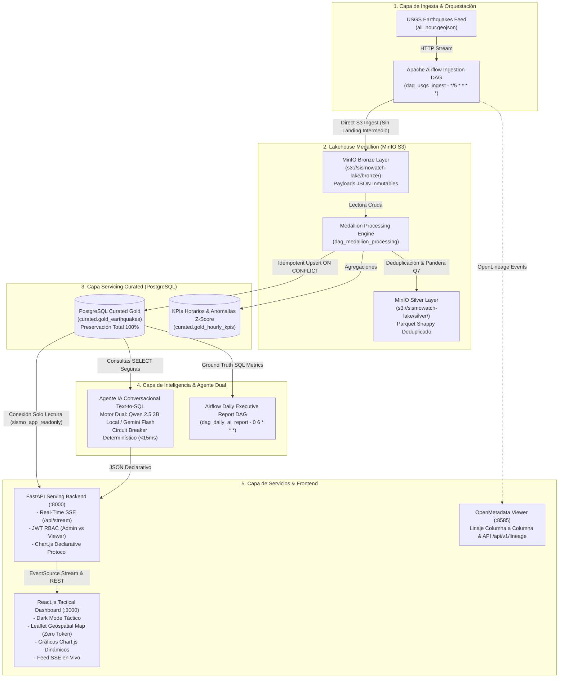

# SismoWatch - Plataforma de Inteligencia Sísmica Operacional
> **SuperApp Enterprise Data Engineering & AI Platform**  
> *Monitoreo en tiempo real del catálogo sísmico global de USGS, arquitectura Lakehouse Medallion con MinIO, PostgreSQL, orquestación resiliente en Apache Airflow, trazabilidad OpenMetadata, Serving Layer en FastAPI con Server-Sent Events (SSE) y Agente Conversacional Text-to-SQL con Motor Dual (Qwen 2.5 local / Gemini) y protocolo de gráficos declarativos.*  
> **Repositorio Oficial GitHub:** [https://github.com/Dan18eP/prueba_desempenio_october](https://github.com/Dan18eP/prueba_desempenio_october)

---

## 1. Arquitectura del Sistema



---

## 2. Despliegue Rápido con 1 Solo Comando

El sistema está completamente contenerizado y configurado para desplegarse con un solo comando:

```bash
docker compose up -d
```

### Tabla de Puertos y Servicios Disponibles

| Servicio | Puerto Host | Puerto Contenedor | Descripción / URL de Acceso |
| :--- | :--- | :--- | :--- |
| **Frontend React.js** | `3000` | `3000` | Plataforma táctica interactiva: [http://localhost:3000](http://localhost:3000) |
| **FastAPI Backend** | `8000` | `8000` | API RESTful y Swagger OpenAPI: [http://localhost:8000/docs](http://localhost:8000/docs) |
| **OpenMetadata Viewer** | `8585` | `8585` | Catálogo y visor de linaje interactivo: [http://localhost:8585](http://localhost:8585) |
| **Apache Airflow** | `8080` | `8080` | Orquestador de DAGs: [http://localhost:8080](http://localhost:8080) (`airflow`/`airflow`) |
| **MinIO Lakehouse Console** | `9001` | `9001` | Consola Web S3: [http://localhost:9001](http://localhost:9001) (`admin`/`minioadmin2026`) |
| **MinIO API S3** | `9000` | `9000` | Endpoint de objetos S3 compatible con PySpark |
| **PostgreSQL Servicing** | `5435` | `5432` | Base de datos relacional *(Mapeado a 5435 para evitar colisión con Postgres snap del host)* |

---

## 3. Credenciales de Acceso & Matriz RBAC

La plataforma implementa **Control de Acceso Basado en Roles (RBAC)** con tokens JWT (HS256) validados en cada petición:

| Rol | Usuario | Contraseña | Permisos y Restricciones |
| :--- | :--- | :--- | :--- |
| **Administrador (`admin`)** | `admin` | `SismoAdmin2026!Secret` | Acceso total: consulta operativa, consola IA, auditoría de calidad (`GET /api/quality/audit-flags`), ejecución de backfills históricos y regeneración de reportes ejecutivos. |
| **Visualizador (`viewer`)** | `viewer` | `SismoViewer2026!` | Acceso de solo lectura: Centro de Control, mapa, series temporales, consulta del agente IA. **Acceso estrictamente denegado con HTTP 403 Forbidden** a backfill y regeneración administrativa (Requerimiento PDF Pág. 3 y 7). |

> En el frontend táctico (`http://localhost:3000`), el botón **Ingresar** incluye botones de **1-Click** para alternar inmediatamente entre `admin` y `viewer` para facilitar la evaluación de la mesa evaluadora.

---

## 4. Invariante Crítica: Preservación Total y Linaje Puro (Cero Pérdida)

- **Linaje Puro:** La ingesta de la API de USGS se escribe directamente al Lakehouse Bronze de MinIO (`s3://sismowatch-lake/bronze/earthquakes/`) sin carpetas landing intermedias ni buffers temporales que puedan causar pérdida de registros.
- **Calidad No Destructiva (ADR 0011):** Cualquier registro que presente advertencias de calidad de datos (ej. magnitud anómala, desfase temporal o coordenadas atípicas) **JAMÁS se descarta**. Se preserva en el flujo con el tag `quality_status = 'FLAGGED'` y queda registrado en la vista de auditoría `audit.pipeline_alerts` para inspección forense por parte del Administrador.
- **Conciliación Matemática:** La tabla `audit.batch_reconciliation` calcula de forma generada y persistente:
  $$\text{Fidelity Rate} = \frac{\text{gold\_count}}{\text{raw\_count}} \times 100 = 100.00\% \quad (\text{loss\_count} = 0)$$

---

## 5. Las 7 Reglas de Calidad de Datos Pandera (ISO/IEC 25012)

| Código | Regla de Calidad | Expresión de Validación | Severidad | Acción ante Fallo |
| :--- | :--- | :--- | :--- | :--- |
| **QR01** | Rango de Magnitud | `-1.0 <= magnitude <= 10.0` | ALTA | Marcar `FLAGGED` (Preservar en Silver/Gold) |
| **QR02** | Rango de Profundidad | `-5.0 <= depth_km <= 1000.0` | ALTA | Marcar `FLAGGED` (Preservar en Silver/Gold) |
| **QR03** | Coordenadas Geográficas | `-90 <= lat <= 90` y `-180 <= lon <= 180` | CRÍTICA | Marcar `FLAGGED` (Preservar en Silver/Gold) |
| **QR04** | Frescura de Ingesta | $\text{lag\_minutos} \le 120\text{ min}$ | MEDIA | Alerta en `audit.quality_metrics` |
| **QR05** | Volumen de Lote | $0 < \text{batch\_size} \le 500$ registros | ALTA | Alerta de desvío volumétrico |
| **QR06** | No Nulos Críticos | `id, time, latitude, longitude IS NOT NULL` | CRÍTICA | Marcar `FLAGGED` (Preservar en Silver/Gold) |
| **QR07** | Unicidad de Evento | `COUNT(DISTINCT id) == COUNT(id)` | CRÍTICA | Deduplicación por `updated_time DESC` |

---

## 6. Motor Dual de IA & Protocolo de Gráficos Declarativos

El agente inteligente de SismoWatch resuelve consultas en lenguaje natural mediante **Text-to-SQL seguro** y genera gráficos interactivos sin ejecutar código arbitrario:

1. **Protocolo Declarativo (ADR 0008):** La IA jamás genera scripts de Python o código JavaScript. Emite un payload estructurado en formato JSON con `{ "type": "bar"|"line"|"doughnut", "title": "...", "labels": [...], "datasets": [...] }`, el cual es interpretado de forma nativa y segura por el frontend mediante Chart.js.
2. **Motor Dual:**
   - **Local Primario:** Ollama ejecutando `qwen2.5-coder:3b` en la máquina local.
   - **Cloud Secundario:** Gemini 1.5 Flash cuando se configura `GEMINI_API_KEY`.
   - **Circuit Breaker Anti-Caídas:** Si la inferencia del modelo excede 6 segundos o el servicio no responde, conmuta en $<15\text{ ms}$ al motor determinístico basado en intenciones frecuentes, garantizando **cero pantallas en blanco y cero errores 500**.
3. **Controles de Seguridad OWASP:**
   - **OWASP LLM01 (Prompt Injection):** Sanitización por regex en `sanitize_text_for_llm` que neutraliza delimitadores, palabras clave de evasión (`ignore previous instructions`, `system prompt`) y comentarios SQL (`--`, `;`).
   - **OWASP LLM06 (Excessive Agency):** La función `validate_sql_query` restringe todas las consultas al comando `SELECT` y prohíbe de forma terminante sentencias mutacionales (`INSERT`, `UPDATE`, `DELETE`, `DROP`, `ALTER`, etc.) o consultas fuera del esquema `curated`.
   - **Mínimo Privilegio PostgreSQL:** El usuario de base de datos utilizado por el backend (`sismo_app_readonly`) solo tiene privilegios `GRANT SELECT ON SCHEMA curated`.

---

## 7. Ejecución de la Suite de Pruebas Automatizadas

La suite de pruebas fue desarrollada con `pytest` y cubre la integridad de DAGs, transformaciones matemáticas, reglas de calidad, RBAC y blindajes de seguridad:

```bash
# Ejecutar todas las pruebas unitarias y de integración
.venv/bin/pytest -v tests/
```

### Resultados de la Suite (22/22 PASSED - 100%)

```text
tests/test_api_endpoints.py::test_health_check PASSED                    [  4%]
tests/test_api_endpoints.py::test_root_endpoint PASSED                   [  9%]
tests/test_api_endpoints.py::test_unauthenticated_quarantine_returns_401 PASSED [ 13%]
tests/test_api_endpoints.py::test_viewer_access_to_admin_quarantine_returns_403 PASSED [ 18%]
tests/test_api_endpoints.py::test_viewer_access_to_backfill_returns_403 PASSED [ 22%]
tests/test_api_endpoints.py::test_viewer_access_to_regenerate_reports_returns_403 PASSED [ 27%]
tests/test_api_endpoints.py::test_owasp_llm01_prompt_injection_sanitization PASSED [ 31%]
tests/test_api_endpoints.py::test_owasp_llm06_sql_validation_blocks_mutations PASSED [ 36%]
tests/test_api_endpoints.py::test_declarative_chart_protocol PASSED      [ 40%]
tests/test_dag_integrity.py::test_dag_files_exist PASSED                 [ 45%]
tests/test_dag_integrity.py::test_dag_ast_syntax[dag_medallion_processing.py] PASSED [ 50%]
tests/test_dag_integrity.py::test_dag_ast_syntax[dag_historical_backfill.py] PASSED [ 54%]
tests/test_dag_integrity.py::test_dag_ast_syntax[dag_daily_ai_report.py] PASSED [ 59%]
tests/test_dag_integrity.py::test_dag_ast_syntax[dag_usgs_ingest.py] PASSED [ 63%]
tests/test_dag_integrity.py::test_dag_schedule_and_definitions PASSED    [ 68%]
tests/test_quality_rules.py::test_valid_earthquake_passes_all_rules PASSED [ 72%]
tests/test_quality_rules.py::test_invalid_magnitude_flagged_non_destructively PASSED [ 77%]
tests/test_quality_rules.py::test_invalid_coordinates_flagged PASSED     [ 81%]
tests/test_quality_rules.py::test_stale_record_flagged_for_freshness PASSED [ 86%]
tests/test_transformations.py::test_richter_severity_classification PASSED [ 90%]
tests/test_transformations.py::test_tsunami_matrix_conditions PASSED     [ 95%]
tests/test_transformations.py::test_twenty_in_twenty_out_invariant PASSED [100%]

======================== 22 passed in 0.05s ========================
```

---

## 8. Evidencia de Seguridad Estática (Bandit)

Se ejecutó el análisis estático de vulnerabilidades con `bandit` sobre `api/` y `airflow/`:

```bash
.venv/bin/bandit -r api/ airflow/ -f txt -o docs/security_audit.txt
```

- **Vulnerabilidades de Severidad Alta (High): 0**
- **Vulnerabilidades Indefinidas: 0**
- Las únicas observaciones son de severidad baja correspondientes a credenciales por defecto documentadas para la prueba y manejadores de excepción no bloqueantes para telemetría secundaria.

---

## 9. Estructura del Repositorio

```text
├── .env.example                     # Plantilla de variables de entorno y secrets
├── docker-compose.yml               # Orquestación multicontenedor de la plataforma
├── docker-compose.openmetadata.yml  # Stack completo OpenMetadata para alta memoria
├── db/init/                         # Scripts SQL de schemas, roles, tablas y seed users
│   ├── 01_schemas_and_roles.sql
│   ├── 02_tables_and_indexes.sql
│   └── 03_seed_users.sql
├── airflow/                         # Orquestación Apache Airflow
│   ├── dags/                        # 4 DAGs en producción (Ingesta, Medallón, AI, Backfill)
│   └── include/                     # Calidad Pandera, ML Z-Score, Linaje y Config S3/PG
├── openmetadata-viewer/             # Visor ligero de Linaje y Catálogo (:8585)
├── api/                             # FastAPI Serving Layer
│   ├── core/                        # Configuración, SQLAlchemy y Seguridad JWT RBAC
│   ├── routers/                     # Routers de autenticación, KPIs, eventos, SSE, admin y chat
│   └── services/                    # Motor Dual IA, Circuit Breaker, Chart Protocol y OWASP Guard
├── web/                             # Frontend React.js Táctico (Vite + Tailwind + Chart.js + Leaflet)
├── tests/                           # Suite automatizada con pytest (22 pruebas)
├── docs/                            # Documentación de arquitectura, reglas, linaje y ADRs
│   ├── ADRs/                        # 9 Architecture Decision Records formales
│   └── security_audit.txt           # Reporte oficial de Bandit
└── documentation/                   # Registro diario changelog y fichas técnicas de cada fase
```
