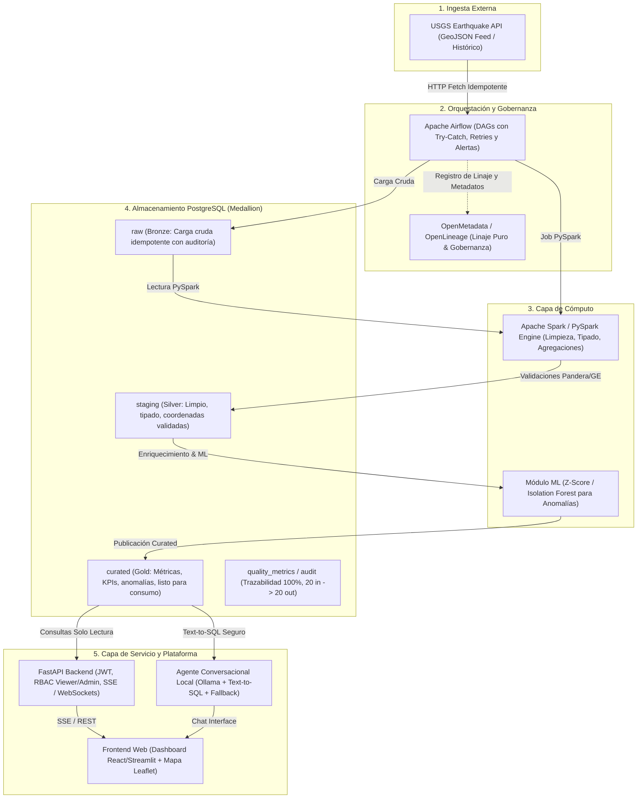

# Documento de Arquitectura - SismoWatch

## 1. Propósito de la Arquitectura
**SismoWatch** es la plataforma de monitoreo sísmico global en tiempo casi real de SuperApp. 

### Problema que resuelve:
- La fuente oficial pública (USGS Earthquake Catalog) entrega feeds en tiempo real sin persistencia histórica propia para analítica, sin validación de integridad y sin enriquecimiento contextual.
- Los equipos de operaciones y gestión de riesgo necesitan visibilidad inmediata de sismos de impacto, detección automática de enjambres/anomalías sísmicas y un asistente conversacional para consultar la capa analítica de datos sin fricción técnica.

### Decisiones que habilita:
- Priorización y despliegue rápido de equipos de emergencia según severidad y alertas de tsunami.
- Análisis de tendencias temporales y agrupamiento espacial en zonas sísmicas críticas.
- Consultas en lenguaje natural directamente sobre la capa Gold/Curated con garantías de no alucinación.

---

## 2. Diagrama de Componentes y Flujo de Datos

---

## 3. Principios y No Negociables Arquitectónicos

1. **Linaje Puro (Sin capa Landing intermedia ni pérdida en Cuarentena):**
   - No existe almacenamiento intermedio volátil ni carpetas landing huérfanas: el dato viaja directamente del feed a la base de datos en el schema `raw` (Bronze).
   - El linaje de extremo a extremo es continuo: `USGS API -> raw -> staging -> curated`.
   - **Regla de Fidelidad (20 recibidos -> 20 mostrados):** Todo dato recibido se audita. Si un registro tiene una advertencia o campo dudoso, se enriquece y marca en la tabla de auditoría de calidad sin descartarse silenciosamente, garantizando balance y conciliación perfecta de volúmenes.

2. **Resiliencia Operativa ("Zero Dumb Crashes"):**
   - Envolvimiento de tareas en bloques defensivos `try-except`.
   - Manejo de fallos en llamadas de red hacia USGS con timeouts estrictos (15s), backoff exponencial y reintentos automáticos.
   - Idempotencia total: Inserciones con `ON CONFLICT (id) DO UPDATE` para tolerar ejecuciones duplicadas de DAGs sin crear duplicados.
   - `max_active_runs = 1` y `execution_timeout` configurados en cada DAG.

3. **Gobernanza con OpenMetadata & Spark:**
   - Modelado de transformaciones de datos distribuidos mediante PySpark para tipado estricto, cálculos analíticos y detección de anomalías.
   - Emisión de linaje de tablas y columnas hacia OpenMetadata / OpenLineage.

4. **Agente Conversacional Local & Alta Disponibilidad:**
   - Modelo LLM local (vía Ollama, optimizado para CPU como Qwen2.5 / Llama3.2).
   - Conectado en modo **solo lectura** a la capa Gold (`curated`).
   - Arquitectura con **Circuit Breaker & Fallback**: Si el LLM local se demora o falla, un motor analítico determinístico entrega la respuesta sin generar errores 500 ni pantallas en blanco.
   - Mitigación de Prompt Injection y sanitización de texto.

---

## 4. Modelo de Capas de Datos (Medallion en PostgreSQL)

- **`raw` (Bronze):** Payload crudo JSON/GeoJSON almacenado con metadatos de ingesta (`ingested_at`, `source_url`, `hash`).
- **`staging` (Silver):** Tablas normalizadas con columnas tipadas (`id`, `mag`, `place`, `time_utc`, `updated_utc`, `latitude`, `longitude`, `depth_km`, `status`, `tsunami`, `sig`).
- **`curated` (Gold):** Vistas y tablas consolidadas para el negocio:
  - `gold_earthquakes`: Eventos sísmicos validados con clasificación de intensidad y alerta.
  - `gold_hourly_kpis`: Métricas agregadas por hora y región.
  - `gold_anomalies`: Detecciones de actividad sísmica inusual (Z-score / ML).
  - `gold_ai_reports`: Reportes ejecutivos diarios generados con cifras verificadas.
- **`quality_metrics`:** Trazabilidad de validaciones de calidad, reglas evaluadas, puntuación y registros con advertencias de auditoría.
