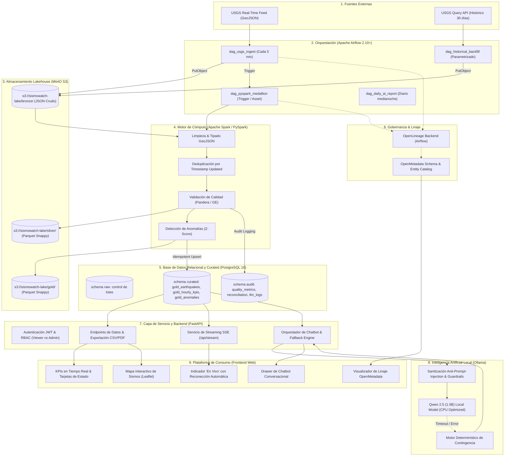

# Documento de Arquitectura de Solución (Solution Architecture) - SismoWatch

## 1. Visión General del Sistema
**SismoWatch** es una plataforma integral de monitoreo sismológico global de misión crítica diseñada para SuperApp. Transforma feeds no estructurados de eventos sísmicos emitidos por el Servicio Geológico de Estados Unidos (USGS) en un producto de datos altamente gobernado, resiliente y accesible mediante analítica predictiva, reportes automatizados y un agente conversacional basado en un Modelo de Lenguaje Local (LLM).

### Principios Rectores:
1. **Desacoplamiento de Cómputo y Almacenamiento:** MinIO como Data Lakehouse Object Storage (Bronze/Silver/Gold Parquet) + PostgreSQL para servicio relacional indexado de alta concurrencia.
2. **Linaje Puro:** Eliminación de carpetas intermedias de aterrizaje ("no landing") y preservación total de los registros ("me llegaron 20, mostré 20").
3. **Resiliencia Operativa ("Zero Dumb Crashes"):** DAGs protegidos con try-catch defensivos, timeouts, reintentos exponenciales e inserciones idempotentes (`ON CONFLICT DO UPDATE`).
4. **Gobernanza Nativa:** Especificación OpenMetadata y emisión de eventos OpenLineage.
5. **Inteligencia Artificial Local y Determinística:** Modelo Qwen 2.5 (1.5B) ejecutado localmente en CPU vía Ollama, protegido con Circuit Breaker y fallback determinístico para garantizar 100% de disponibilidad.

---

## 2. Diagrama de Arquitectura de Componentes

---

## 3. Topología de Red y Contenedores (`docker-compose.yml`)

El sistema completo se orquesta con un solo comando (`docker compose up -d`) en una red puente aislada (`sismowatch-net`):

| Servicio | Imagen Base | Puerto Expuesto | Función Principal | Límites de Recursos Estimados |
| :--- | :--- | :--- | :--- | :--- |
| `postgres` | `postgres:16-alpine` | `5432:5432` | Metadatos de Airflow + Capa Curated y Auditoría | 512 MB RAM |
| `minio` | `minio/minio:RELEASE.2024-05-10T01-41-38Z` | `9000:9000`, `9001:9001` | Lakehouse S3 Object Storage (Bronze, Silver, Gold) | 256 MB RAM |
| `minio-init` | `minio/mc:latest` | N/A (One-shot) | Creación automática del bucket `sismowatch-lake` | 64 MB RAM |
| `airflow-webserver` | `apache/airflow:2.10.2-python3.11` | `8080:8080` | Interfaz de administración de Airflow | 768 MB RAM |
| `airflow-scheduler` | `apache/airflow:2.10.2-python3.11` | N/A | Planificador de DAGs y orquestador PySpark | 1024 MB RAM |
| `ollama` | `ollama/ollama:latest` | `11434:11434` | Servidor del modelo local Qwen 2.5 (1.5B) en CPU | 1536 MB RAM |
| `api` | Custom (`python:3.11-slim`) | `8000:8000` | Backend FastAPI, JWT, SSE y Chatbot Orchestrator | 384 MB RAM |
| `web` | Custom (`python:3.11-slim`) | `3000:3000` | Frontend Dashboard, Mapa y Chatbot UI | 384 MB RAM |

*Consumo Total Estimado de RAM:* $\approx 4.8 \text{ GB}$, operando dentro del margen seguro de los 5.9 GB libres de la máquina.

---

## 4. Estrategia de Seguridad y Mínimo Privilegio

### Roles de Base de Datos PostgreSQL:
1. `sismo_ingest_role`: Permisos exclusivos de escritura sobre `audit.batch_reconciliation` y metadatos de ingesta.
2. `sismo_transform_role`: Permisos de lectura en `raw` y escritura completa en `curated` y `audit`.
3. `sismo_api_readonly_role`: Acceso exclusivo de solo lectura (`SELECT`) sobre el schema `curated` y tablas públicas de métricas de calidad. **La API jamás tiene permisos de modificación ni acceso a capas internas.**

### Autenticación y Control de Acceso (RBAC):
- Autenticación mediante tokens criptográficos **JWT (JSON Web Tokens)** con algoritmo HMAC-SHA256 y expiración configurable (60 minutos).
- **Roles de Usuario:**
  - `viewer`: Visualización de dashboard, gráficos temporales, mapa, reportes IA y stream en vivo.
  - `admin`: Acceso a triggers de backfill histórico, regeneración de reportes IA y consulta de registros con alertas en cuarentena (`/api/quality/quarantine`).
- **Validación de Entradas y Prompt Injection:**
  - El campo `place` de USGS es sanitizado mediante expresiones regulares estrictas antes de incluirlo en cualquier prompt al LLM, neutralizando ataques de inyección de instrucciones (OWASP LLM01).

---

## 5. Decisiones de Diseño y Trade-Offs

### ¿Por qué Airflow y no un simple Cron?
- Airflow provee manejo de dependencias acíclicas complejas (DAGs), estado persistente, backfill histórico parametrizado, reintentos con backoff exponencial, trazabilidad de logs por tarea y métricas de SLAs que un cron job en Linux no puede garantizar.

### ¿Por qué MinIO y no persistir todo en PostgreSQL?
- Un Data Lakehouse moderno separa el almacenamiento de cómputo. MinIO permite almacenar los payloads JSON GeoJSON crudos y los datos en Parquet particionado a costo de almacenamiento casi nulo, permitiendo reprocesar desde cero sin saturar las tablas relacionales de PostgreSQL.

### ¿Qué harías diferente en un entorno de producción a gran escala?
1. **Infraestructura:** En lugar de contenedores locales, desplegar en Kubernetes (EKS / GKE) con Airflow en modo `CeleryExecutor` o `KubernetesExecutor`.
2. **Object Storage:** Reemplazar MinIO local por AWS S3 / Google Cloud Storage con políticas de ciclo de vida (Tiering a Glacier / Archive para datos Bronze mayores a 90 días).
3. **Cómputo:** Conectar Airflow a un cluster gestionado de Apache Spark (Databricks o EMR / Dataproc) mediante `SparkSubmitOperator` para procesar petabytes de datos sísmicos históricos mundiales.
4. **Catálogo de Metadatos:** Conectar el emisor OpenLineage a un clúster empresarial de OpenMetadata de alta disponibilidad con réplicas dedicadas de OpenSearch.
