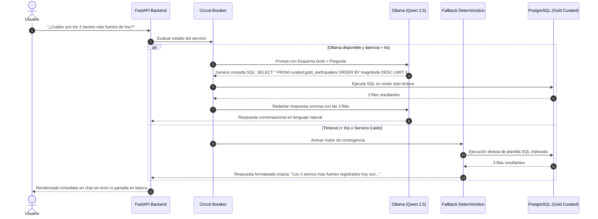

# Especificación de Lógica de Negocio y Algoritmos (Business Logic) - SismoWatch

## 1. Contexto de Negocio y Casos de Uso
**SuperApp SismoWatch** proporciona inteligencia sísmica operacional para coordinar respuestas ante emergencias naturales. Las áreas de riesgo de la compañía requieren detectar sismos de impacto en menos de 5 minutos, monitorear enjambres sísmicos anómalos y disponer de un asistente conversacional que responda preguntas analíticas instantáneas basadas en datos verificados.

---

## 2. Clasificación de Severidad y Priorización de Alertas

### Escala de Magnitud de Richter Adaptada:
Cada evento procesado en PySpark se clasifica automáticamente según su magnitud ($M$):

| Rango de Magnitud ($M$) | Clasificación (`severity_label`) | Nivel de Alerta Operacional | Color en Dashboard |
| :--- | :--- | :--- | :--- |
| $M < 2.5$ | `Micro` | Informativo (Sin percepción humana) | Verde (`#22c55e`) |
| $2.5 \le M < 4.5$ | `Menor` | Monitoreo estándar | Azul (`#3b82f6`) |
| $4.5 \le M < 6.0$ | `Moderado` | Alerta Amarilla (Daños potenciales leves) | Amarillo (`#eab308`) |
| $6.0 \le M < 7.0$ | `Fuerte` | Alerta Naranja (Daños estructurales moderados) | Naranja (`#f97316`) |
| $M \ge 7.0$ | `Mayor` | Alerta Roja (Emergencia crítica y posible devastación) | Rojo (`#ef4444`) |

### Matriz de Prioridad de Alerta de Tsunami:
Un sismo activa el protocolo de **Alerta Crítica de Tsunami** si cumple:
$$\text{Alerta Tsunami} = \text{TRUE} \quad \iff \quad (\text{tsunami} = 1) \lor (M \ge 6.8 \land \text{depth\_km} \le 100.0)$$

---

## 3. Algoritmo Analítico de Detección de Anomalías (Machine Learning / Estadístico)

Para detectar comportamientos inusuales como **enjambres sísmicos** o **picos súbitos de energía**, PySpark ejecuta una técnica analítica basada en **Z-Score Robusto y Ventanas Deslizantes**:

### Formulación Matemática:
Para una ventana temporal $W$ (últimas 24 horas) en una región o celda geográfica:
1. Se calcula la media regional de magnitud ($\mu_M$) y su desviación estándar ($\sigma_M$):
   $$\mu_M = \frac{1}{N} \sum_{i=1}^N M_i, \quad \sigma_M = \sqrt{\frac{1}{N} \sum_{i=1}^N (M_i - \mu_M)^2}$$
2. Para cada sismo entrante $M_i$, se calcula su $Z\text{-Score}$:
   $$Z_i = \frac{M_i - \mu_M}{\sigma_M}$$
3. Se calcula la frecuencia horaria de eventos ($F_h$). Si la tasa horaria excede el percentil 95 histórico ($\lambda_{P95}$):
   $$\text{Es Enjambre} = \text{TRUE} \quad \iff \quad F_h > \lambda_{P95}$$

### Criterio de Clasificación de Anomalía:
Un sismo se etiqueta como `is_anomaly = TRUE` si:
$$Z_i > 2.5 \quad \lor \quad (\text{Es Enjambre} = \text{TRUE} \land M_i \ge 4.0)$$

Cada anomalía genera una explicación breve y determinística en la columna `anomaly_explanation` (ejemplo: *"Sismo de magnitud 5.8 supera en 2.87 desviaciones estándar el promedio regional (mu=3.10) en las últimas 24 horas"*).

---

## 4. Algoritmo y Fórmula de Calidad de Datos (Quality Scoring)

El módulo de calidad evalúa 7 reglas obligatorias sobre cada lote:
1. **Unicidad:** `id` no duplicado en el lote actual.
2. **Campos Mandatorios:** `id`, `time`, `coordinates` no nulos.
3. **Rango de Latitud:** $-90.0 \le \text{latitude} \le 90.0$.
4. **Rango de Longitud:** $-180.0 \le \text{longitude} \le 180.0$.
5. **Plausibilidad de Profundidad:** $\text{depth\_km} \ge -5.0 \land \text{depth\_km} \le 800.0$.
6. **Plausibilidad de Magnitud:** $M \ge -2.0 \land M \le 10.0$.
7. **Consistencia Temporal:** $\text{event\_time\_utc} \le \text{now}() + 10 \text{ minutos}$.

### Cálculo del Puntaje de Calidad ($Q$):
$$Q = \left( \frac{\sum_{r=1}^{R} \text{Aprobadas}_r}{\sum_{r=1}^{R} \text{Evaluadas}_r} \right) \times 100\%$$
- Si $Q \ge 95\%$: Calidad Excelente (Verde).
- Si $85\% \le Q < 95\%$: Calidad Aceptable con Alertas (Amarillo).
- Si $Q < 85\%$: Calidad Crítica / Requiere Auditoría Inmediata (Rojo).

---

## 5. Control de Alucinaciones en IA y Reporte Narrativo Diario

El DAG diario `dag_daily_ai_report` consolida la actividad de las últimas 24 horas siguiendo un protocolo estricto:

### 1. Cálculo Previo en SQL (Ground Truth):
Las métricas matemáticas se extraen directamente de `curated.gold_hourly_kpis` mediante SQL:
- `total_events`
- `max_magnitude`
- `avg_magnitude`
- `tsunami_alerts_count`
- `top_active_region`
- `detected_anomalies_count`

### 2. Generación Guiada con Pydantic:
El LLM Qwen 2.5 recibe los valores exactos en el prompt del sistema y debe responder según el siguiente esquema JSON:
```json
{
  "title": "Reporte Ejecutivo Sísmico Diario",
  "period": "2026-10-26T00:00:00Z a 2026-10-26T23:59:59Z",
  "summary": "Texto narrativo profesional...",
  "verified_metrics": {
    "total_events": 142,
    "max_magnitude": 6.4,
    "avg_magnitude": 3.12,
    "tsunami_count": 0
  },
  "most_active_region": "Southern California",
  "risk_assessment": "Bajo / Moderado / Alto"
}
```

### 3. Validación Matemática de Coincidencia:
El pipeline de Python compara mediante expresiones regulares los números citados en el campo `summary` con los valores de `verified_metrics`. Si existe discrepancia mayor al $0\%$, el reporte activa una corrección automática o el fallback determinístico.

---

## 6. Agente Conversacional Local: Motor de Consultas y Circuit Breaker

### Flujo de Interacción:


---

## 7. Modelo de Seguridad y Matriz de Roles (RBAC)

| Capacidad / Endpoint | Visitante (Sin Login) | Viewer | Admin | Justificación Operativa |
| :--- | :---: | :---: | :---: | :--- |
| **Acceso a Login (`POST /auth/login`)** | Sí | Sí | Sí | Autenticación pública para emisión de JWT. |
| **Dashboard y KPIs (`GET /api/kpis`)** | No | Sí | Sí | Visualización de indicadores operativos agregados. |
| **Consulta de Eventos (`GET /api/events`)** | No | Sí | Sí | Búsqueda, paginación y filtros de sismos en Gold. |
| **Mapa Interactivo y Gráficos** | No | Sí | Sí | Análisis visual geoespacial y series de tiempo. |
| **Streaming en Tiempo Real (`GET /api/stream`)** | No | Sí | Sí | Notificaciones push de nuevos sismos vía SSE. |
| **Historial de Reportes IA (`GET /api/reports`)** | No | Sí | Sí | Descarga de reportes en PDF y CSV. |
| **Auditoría de Cuarentena (`GET /api/quality/quarantine`)** | No | No | **Sí** | Exclusivo para administradores y auditores de datos. |
| **Disparo de Backfill (`POST /api/admin/backfill`)** | No | No | **Sí** | Operación pesada de ingesta histórica de 30 días. |
| **Regenerar Reporte IA (`POST /api/admin/reports/regenerate`)**| No | No | **Sí** | Forzado manual de síntesis generativa. |
