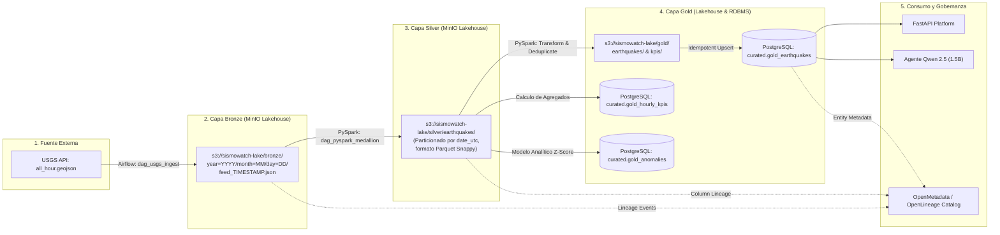

# Especificación de Linaje Puro de Datos (Data Lineage) - SismoWatch

## 1. Visión General del Linaje Puro
El principio de **Linaje Puro** en SismoWatch establece que todo dato tiene una procedencia demostrable, determinística y continua, eliminando capas intermedias de aterrizaje huérfanas ("landing folders") y prohibiendo la pérdida destructiva de registros en cuarentenas segregadas.

```
┌─────────────────┐       ┌─────────────────┐       ┌─────────────────┐       ┌────────────────────────┐
│    USGS Feed    │  ──>  │  MinIO (Bronze) │  ──>  │  MinIO (Silver) │  ──>  │  PostgreSQL (Curated)  │
│  API (GeoJSON)  │       │  Immutable JSON │       │  Columnar Snappy│       │  Gold Schemas & Tables │
└─────────────────┘       └─────────────────┘       └─────────────────┘       └────────────────────────┘
```

---

## 2. Diagrama de Linaje de Extremo a Extremo



---

## 3. Mapeo de Transformación Columna por Columna (Column-Level Lineage)

| Fuente GeoJSON (`properties` / `geometry`) | Capa Bronze (JSON Crudo) | Capa Silver (Parquet Tipado) | Capa Gold (PostgreSQL Curated) | Regla de Transformación / Normalización |
| :--- | :--- | :--- | :--- | :--- |
| `id` | `id` (string) | `id` (VARCHAR 64) | `id` (PRIMARY KEY) | Extracción directa, identificador único universal de USGS. |
| `properties.mag` | `mag` (float) | `magnitude` (DOUBLE) | `magnitude` (DECIMAL 4,2) | Conversión a número decimal flotante con redondeo a 2 dígitos. |
| `properties.place` | `place` (string) | `place` (VARCHAR 255) | `place` (VARCHAR 255) | Sanitización de caracteres de control para prevenir Prompt Injection. |
| `properties.time` | `time` (epoch ms) | `event_time_utc` (TIMESTAMP) | `event_time_utc` (TIMESTAMP WITH TZ) | Conversión de milisegundos epoch UNIX a UTC: `to_timestamp(time / 1000)`. |
| `properties.updated` | `updated` (epoch ms) | `updated_time_utc` (TIMESTAMP)| `updated_time_utc` (TIMESTAMP) | Timestamp de última revisión. Clave de deduplicación de eventos. |
| `geometry.coordinates[0]` | `coordinates[0]` | `longitude` (DOUBLE) | `longitude` (DECIMAL 9,6) | Extracción posicional del array. Validación rango $[-180.0, 180.0]$. |
| `geometry.coordinates[1]` | `coordinates[1]` | `latitude` (DOUBLE) | `latitude` (DECIMAL 9,6) | Extracción posicional del array. Validación rango $[-90.0, 90.0]$. |
| `geometry.coordinates[2]` | `coordinates[2]` | `depth_km` (DOUBLE) | `depth_km` (DECIMAL 6,2) | Profundidad hipocentral en kilómetros. Validación plausibilidad ($\ge -5.0$). |
| `properties.tsunami` | `tsunami` (int) | `tsunami_alert` (BOOLEAN) | `tsunami_alert` (BOOLEAN) | Mapeo booleano: `CASE WHEN tsunami = 1 THEN TRUE ELSE FALSE END`. |
| `properties.sig` | `sig` (int) | `significance` (INTEGER) | `significance` (INTEGER) | Índice de significancia del evento sísmico (0 a 1000). |
| `properties.status` | `status` (string) | `review_status` (VARCHAR 32) | `review_status` (VARCHAR 32) | Estado del evento: `automatic` vs `reviewed`. |
| `properties.type` | `type` (string) | `event_type` (VARCHAR 32) | `event_type` (VARCHAR 32) | Tipo de evento sísmico (earthquake, quarry blast, etc.). |
| *Calculado en PySpark* | N/A | `quality_status` (VARCHAR 16) | `quality_status` (VARCHAR 16) | Flag de calidad (`VALID` vs `FLAGGED`). |
| *Calculado en PySpark* | N/A | `severity_label` (VARCHAR 16) | `severity_label` (VARCHAR 16) | Escala categórica: Micro ($<2.5$), Menor ($2.5-4.4$), Moderado ($4.5-5.9$), Fuerte ($6.0-6.9$), Mayor ($\ge 7.0$). |
| *Calculado en PySpark* | N/A | `is_anomaly` (BOOLEAN) | `is_anomaly` (BOOLEAN) | Resultado del modelo Z-Score ($Z > 2.5$) sobre magnitud regional. |

---

## 4. Regla de Balance y Conciliación: "Me llegaron 20, mostré 20"

Para garantizar la auditoría y evitar discrepancias de volumen en las sustentaciones:

1. **Conteo en Ingesta ($N_{raw}$):**
   - El DAG de ingesta cuenta exactamente los elementos del array `features` en el GeoJSON de USGS ($N_{raw} = 20$).
   - Este valor se almacena como metadato del lote en `audit.batch_reconciliation (batch_id, raw_count, ingested_at)`.

2. **Conteo en Silver ($N_{silver}$):**
   - PySpark procesa los $N_{raw}$ eventos.
   - Aplica deduplicación por `id` ordenando por `updated DESC`.
   - Si no hay duplicados en el feed, $N_{silver} = N_{raw} = 20$.
   - Si un evento incumple una regla de calidad (ej. profundidad atípica), se marca como `quality_status = 'FLAGGED'`, pero **se mantiene en Silver y Gold**, registrando el incidente en `audit.quality_metrics`.

3. **Conteo en Gold ($N_{gold}$):**
   - La sincronización a PostgreSQL inserta o actualiza los 20 registros.
   - La métrica expuesta al dashboard refleja:
     $$\text{Tasa de Fidelidad} = \frac{N_{gold}}{N_{raw}} \times 100\% = \frac{20}{20} \times 100\% = 100\%$$

---

## 5. Especificación de Entidades para OpenMetadata

Para interoperabilidad con OpenMetadata sin sobrecargar la memoria de la máquina, se generan los manifiestos JSON con el esquema estándar de OpenMetadata:

### Identificadores FQN (Fully Qualified Names):
- **Servicio Lakehouse:** `minio_sismowatch_lake`
  - Base de datos: `lakehouse`
    - Schema: `bronze` $\to$ Dataset: `bronze.usgs_feed`
    - Schema: `silver` $\to$ Dataset: `silver.earthquakes`
    - Schema: `gold` $\to$ Dataset: `gold.curated_earthquakes`
- **Servicio PostgreSQL:** `postgres_sismowatch`
  - Base de datos: `sismowatch`
    - Schema: `curated` $\to$ Tabla: `curated.gold_earthquakes`
    - Schema: `curated` $\to$ Tabla: `curated.gold_hourly_kpis`
    - Schema: `curated` $\to$ Tabla: `curated.gold_anomalies`
    - Schema: `audit` $\to$ Tabla: `audit.quality_metrics`

### Pipeline Lineage en OpenMetadata:
- **Pipeline:** `airflow.sismowatch_orchestrator`
  - Tarea 1: `dag_usgs_ingest.fetch_and_store_bronze`
    - *Entrada:* `https://earthquake.usgs.gov/earthquakes/feed/v1.0/summary/all_hour.geojson`
    - *Salida:* `minio_sismowatch_lake.bronze.usgs_feed`
  - Tarea 2: `dag_pyspark_medallion.transform_silver_gold`
    - *Entrada:* `minio_sismowatch_lake.bronze.usgs_feed`
    - *Salida:* `minio_sismowatch_lake.silver.earthquakes`, `postgres_sismowatch.curated.gold_earthquakes`
  - Tarea 3: `dag_daily_ai_report.generate_executive_summary`
    - *Entrada:* `postgres_sismowatch.curated.gold_earthquakes`, `postgres_sismowatch.curated.gold_hourly_kpis`
    - *Salida:* `postgres_sismowatch.curated.gold_ai_reports`
